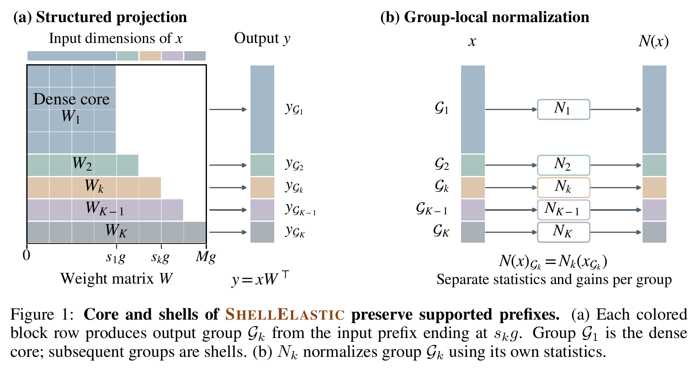
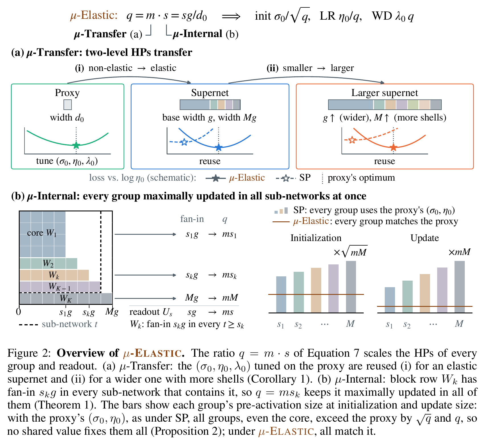
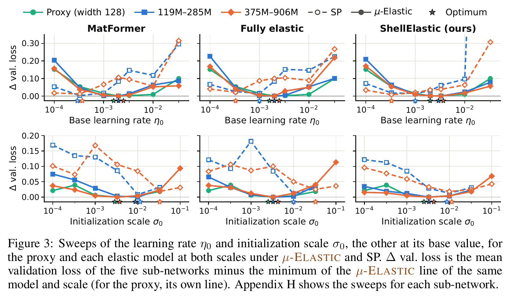
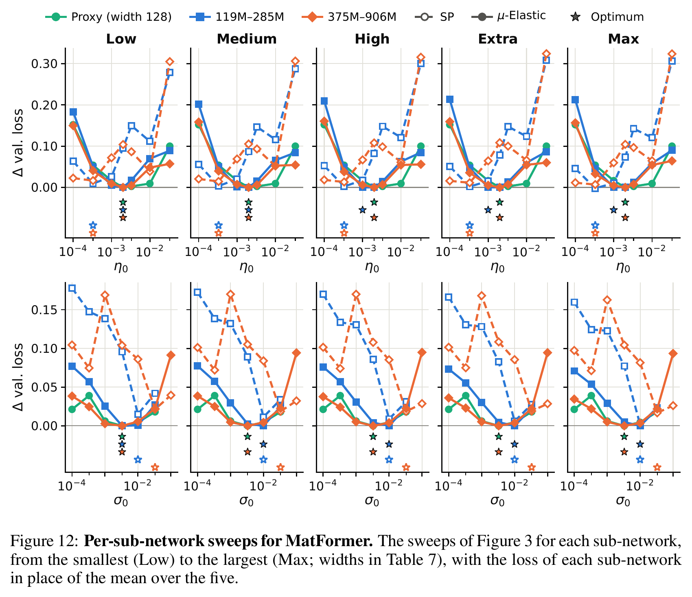
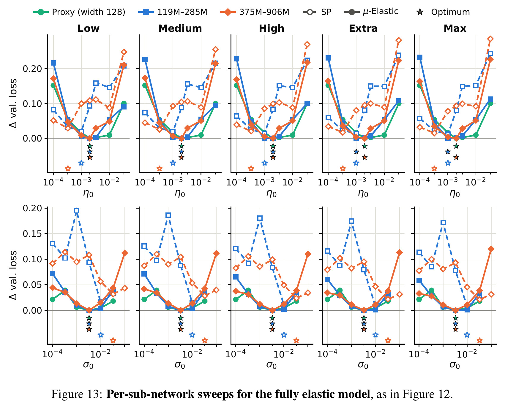
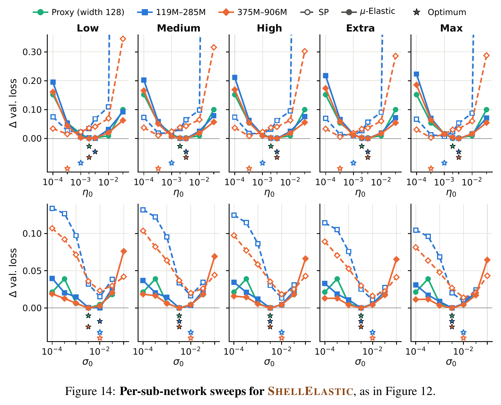
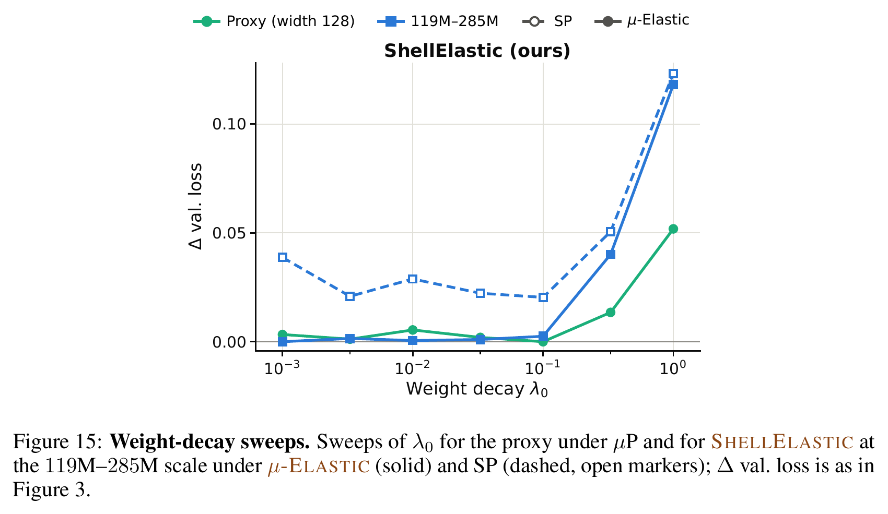
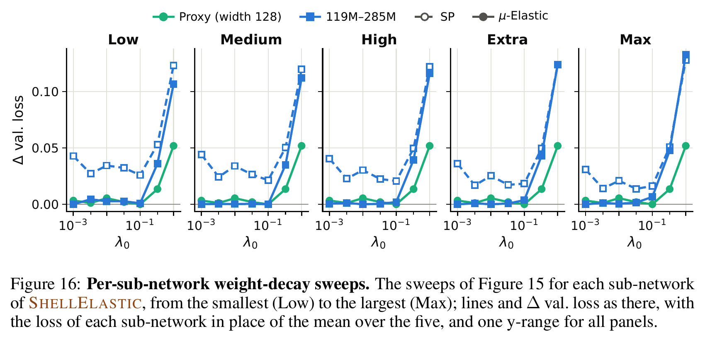
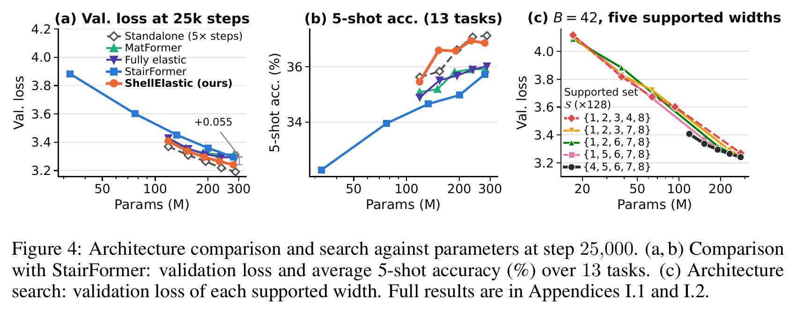

<div align="center">

<h1>
  <picture>
    <source media="(prefers-color-scheme: dark)" srcset="assets/shellelastic-logo-dark.svg">
    
  </picture>
</h1>

### Scalable Elastic Pretraining<br>with Simultaneous Maximal Updates and Hyperparameter Transfer

<sub>**Can Jin**<sup>1*</sup> · **Yan Kang**<sup>2</sup> · **Yifan Gong**<sup>2</sup> · **Chongjian Ge**<sup>2</sup> · **Mingze Xu**<sup>2</sup> · **Yuanjun Xiong**<sup>2</sup> · **Dimitris N. Metaxas**<sup>1</sup> · **Hongwu Peng**<sup>2</sup></sub>

<sub><sup>1</sup>Rutgers University &emsp; <sup>2</sup>Adobe Research</sub>

<sub><sup>*</sup>Corresponding author: can.jin@rutgers.edu. Work done during an internship at Adobe Research.</sub>

<a href="https://arxiv.org/pdf/2610.15124"></a>
<a href="https://jincan333.github.io/ShellElastic_page"></a>
<a href="https://github.com/jincan333/ShellElastic"></a>
<a href="https://huggingface.co/spaces/Can111/ShellElastic"></a>
<a href="https://huggingface.co/spaces/Can111/ShellElastic"></a>
<a href="LICENSE"></a>

</div>

## 📖 Overview

Elastic pretraining trains several nested sub-networks of different sizes inside one weight-shared
supernet, so that a single run serves several inference budgets. ShellElastic makes this scalable:
its hidden dimensions form a dense core followed by shells, so one full-width forward pass computes
every sub-network exactly and each step costs about as much as training the widest sub-network
alone. μ-Elastic, an extension of μP to ShellElastic and other elastic models, keeps all
sub-networks maximally updated at once and transfers hyperparameters tuned on a small non-elastic
proxy to elastic models and to larger supernets. At three scales from 119M to 1.69B parameters, one
ShellElastic run produces sub-networks that outperform MatFormer and fully elastic baselines at
matched parameter counts and approach separately trained models that together take five times the
steps.

## 🧩 Method

### The ShellElastic architecture

<p align="center">
  
</p>

ShellElastic (Figure 1) partitions the residual stream into a dense core followed by ordered shells,
each a multiple of a base width *g*, and each supported sub-network is the core plus a prefix of the
shells. Every hidden matrix is block lower triangular: a shell reads the core, the earlier shells
and itself, but never a later shell. Trunk normalization acts within each group, attention heads
align with the group boundaries, and every supported width has its own readout. One full-width
forward pass therefore contains the exact hidden states of every sub-network as prefixes
(Proposition 1), and the per-step compute stays close to that of a single full-width pass however
many sub-networks are trained, so every step has a fixed workload, as in non-elastic training.

### μ-Elastic: parameterizing elastic models

<p align="center">
  
</p>

μ-Elastic (Figure 2) extends maximal update parameterization (μP) (Yang et al., 2021) to elastic
models with two factors: a μ-Transfer factor *m* = *g*/*d*<sub>0</sub> that carries HPs from a
non-elastic proxy of width *d*<sub>0</sub> to base width *g*, and a μ-Internal factor for the
different widths inside one shared model. Every group reads the same input coordinates in every
sub-network that contains it, so we set its initialization, learning rate and weight decay from this
fan-in, while each readout uses its own input width (Table 1). This keeps every group maximally
updated in all sub-networks at once (Theorem 1), which uniform scaling across groups cannot do in
general (Proposition 2). The same two factors apply to MatFormer and to fully elastic models
(Appendix D). The standard parameterization (SP) sets both factors and the FFN expansion *e* to one
in the scaling rules and fixes the readout scalars α<sub>s</sub> = 1, preserving the architecture.

**Recipe.**

1. Tune (σ<sub>0</sub>, η<sub>0</sub>, λ<sub>0</sub>) on a non-elastic proxy of width *d*<sub>0</sub>.
2. Choose the base width *g* and the supported set 𝒮.
3. Compute *m* = *g*/*d*<sub>0</sub> and instantiate the parameterization in Table 1.
4. Train the supernet on the joint objective (Equation 8).

## 📊 Results

### Main results

<b>Table 2.</b> Final validation loss and mean 5-shot accuracy over 13 downstream tasks at three scales, labeled by sub-network size. Entries at the 119M–285M and 375M–906M scales average three runs; those at 675M–1.69B are single runs. †Five separately trained models, together taking 5× the steps of any other row. Bold marks the best of the four methods that train all five sizes in one run.

<table>
  <thead>
    <tr>
      <th rowspan="2" align="left">Method</th>
      <th colspan="6" align="center">Val. loss ↓</th>
      <th colspan="6" align="center">5-shot acc. (%) ↑</th>
    </tr>
    <tr>
      <th align="center">Low</th>
      <th align="center">Medium</th>
      <th align="center">High</th>
      <th align="center">Extra</th>
      <th align="center">Max</th>
      <th align="center">Avg.</th>
      <th align="center">Low</th>
      <th align="center">Medium</th>
      <th align="center">High</th>
      <th align="center">Extra</th>
      <th align="center">Max</th>
      <th align="center">Avg.</th>
    </tr>
  </thead>
  <tbody>
    <tr><td colspan="13" align="center"><i>119M–285M</i></td></tr>
    <tr><td align="left">Standalone†</td><td align="center">3.369</td><td align="center">3.308</td><td align="center">3.264</td><td align="center">3.219</td><td align="center">3.191</td><td align="center">3.270</td><td align="center">35.6</td><td align="center">35.8</td><td align="center">36.6</td><td align="center">37.1</td><td align="center">37.1</td><td align="center">36.5</td></tr>
    <tr><td align="left">Sampled standalone</td><td align="center">3.667</td><td align="center">3.609</td><td align="center">3.583</td><td align="center">3.532</td><td align="center">3.524</td><td align="center">3.583</td><td align="center">33.8</td><td align="center">33.4</td><td align="center">34.0</td><td align="center">34.2</td><td align="center">34.4</td><td align="center">34.0</td></tr>
    <tr><td align="left">MatFormer</td><td align="center">3.425</td><td align="center">3.357</td><td align="center">3.325</td><td align="center">3.312</td><td align="center">3.314</td><td align="center">3.347</td><td align="center">35.1</td><td align="center">35.2</td><td align="center">35.8</td><td align="center">35.9</td><td align="center">35.9</td><td align="center">35.6</td></tr>
    <tr><td align="left">Fully elastic</td><td align="center">3.429</td><td align="center">3.354</td><td align="center">3.315</td><td align="center">3.295</td><td align="center">3.290</td><td align="center">3.336</td><td align="center">34.9</td><td align="center">35.5</td><td align="center">35.7</td><td align="center">35.9</td><td align="center">36.0</td><td align="center">35.6</td></tr>
    <tr><td align="left">ShellElastic</td><td align="center"><b>3.409</b></td><td align="center"><b>3.338</b></td><td align="center"><b>3.294</b></td><td align="center"><b>3.264</b></td><td align="center"><b>3.240</b></td><td align="center"><b>3.309</b></td><td align="center"><b>35.5</b></td><td align="center"><b>36.6</b></td><td align="center"><b>36.6</b></td><td align="center"><b>36.9</b></td><td align="center"><b>36.9</b></td><td align="center"><b>36.5</b></td></tr>
    <tr><td colspan="13" align="center"><i>375M–906M</i></td></tr>
    <tr><td align="left">Standalone†</td><td align="center">3.007</td><td align="center">2.963</td><td align="center">2.926</td><td align="center">2.897</td><td align="center">2.870</td><td align="center">2.933</td><td align="center">40.4</td><td align="center">41.8</td><td align="center">42.5</td><td align="center">43.2</td><td align="center">43.1</td><td align="center">42.2</td></tr>
    <tr><td align="left">Sampled standalone</td><td align="center">3.208</td><td align="center">3.175</td><td align="center">3.141</td><td align="center">3.115</td><td align="center">3.093</td><td align="center">3.147</td><td align="center">37.7</td><td align="center">37.8</td><td align="center">38.0</td><td align="center">38.7</td><td align="center">39.0</td><td align="center">38.2</td></tr>
    <tr><td align="left">MatFormer</td><td align="center">3.072</td><td align="center">3.005</td><td align="center">2.975</td><td align="center">2.963</td><td align="center">2.963</td><td align="center">2.996</td><td align="center">39.7</td><td align="center">40.3</td><td align="center">40.4</td><td align="center">41.2</td><td align="center">41.3</td><td align="center">40.6</td></tr>
    <tr><td align="left">Fully elastic</td><td align="center"><b>3.052</b></td><td align="center"><b>2.995</b></td><td align="center"><b>2.966</b></td><td align="center">2.952</td><td align="center">2.948</td><td align="center">2.983</td><td align="center">40.3</td><td align="center">41.0</td><td align="center">41.6</td><td align="center">42.0</td><td align="center">42.0</td><td align="center">41.4</td></tr>
    <tr><td align="left">ShellElastic</td><td align="center">3.055</td><td align="center">3.000</td><td align="center">2.967</td><td align="center"><b>2.943</b></td><td align="center"><b>2.925</b></td><td align="center"><b>2.978</b></td><td align="center"><b>40.8</b></td><td align="center"><b>41.4</b></td><td align="center"><b>42.0</b></td><td align="center"><b>42.6</b></td><td align="center"><b>43.0</b></td><td align="center"><b>41.9</b></td></tr>
    <tr><td colspan="13" align="center"><i>675M–1.69B</i></td></tr>
    <tr><td align="left">Standalone†</td><td align="center">2.912</td><td align="center">2.859</td><td align="center">2.821</td><td align="center">2.793</td><td align="center">2.767</td><td align="center">2.830</td><td align="center">43.4</td><td align="center">43.9</td><td align="center">44.7</td><td align="center">46.2</td><td align="center">46.1</td><td align="center">44.8</td></tr>
    <tr><td align="left">Sampled standalone</td><td align="center">3.037</td><td align="center">2.998</td><td align="center">2.970</td><td align="center">2.956</td><td align="center">2.924</td><td align="center">2.977</td><td align="center">40.2</td><td align="center">40.8</td><td align="center">41.6</td><td align="center">41.0</td><td align="center">43.2</td><td align="center">41.4</td></tr>
    <tr><td align="left">MatFormer</td><td align="center"><b>2.914</b></td><td align="center">2.872</td><td align="center">2.849</td><td align="center">2.839</td><td align="center">2.838</td><td align="center">2.862</td><td align="center">42.8</td><td align="center">43.3</td><td align="center">43.4</td><td align="center">44.0</td><td align="center">43.6</td><td align="center">43.4</td></tr>
    <tr><td align="left">Fully elastic</td><td align="center">2.940</td><td align="center">2.884</td><td align="center">2.854</td><td align="center">2.838</td><td align="center">2.833</td><td align="center">2.870</td><td align="center">42.1</td><td align="center">43.4</td><td align="center"><b>43.9</b></td><td align="center">44.2</td><td align="center"><b>44.6</b></td><td align="center">43.6</td></tr>
    <tr><td align="left">ShellElastic</td><td align="center"><b>2.914</b></td><td align="center"><b>2.866</b></td><td align="center"><b>2.835</b></td><td align="center"><b>2.813</b></td><td align="center"><b>2.796</b></td><td align="center"><b>2.845</b></td><td align="center"><b>43.7</b></td><td align="center"><b>43.7</b></td><td align="center"><b>43.9</b></td><td align="center"><b>44.3</b></td><td align="center">44.5</td><td align="center"><b>44.0</b></td></tr>
  </tbody>
</table>

Among the methods that train all five sizes in one run, ShellElastic has the lowest mean validation
loss (0.028, 0.005 and 0.018 nats below the best baseline) and the highest mean 5-shot accuracy at
every scale, and is best or tied-best at 12 of the 15 tiers in validation loss and 14 in 5-shot
accuracy. With a fifth of their optimizer steps, ShellElastic comes within 0.039, 0.045 and 0.014
nats of the standalone models in mean validation loss and within 0.8 points in mean 5-shot
accuracy.

### Transferability of μ-Elastic

<table>
  <tr>
    <td nowrap>
      &emsp;
      &emsp;
      &emsp;
      &emsp;
      &emsp;
      
    </td>
  </tr>
</table>

<p align="center"><sub>Scroll sideways: Figure 3, then Figures 12–16 of Appendix H (each sub-network, and weight decay).</sub></p>

Under μ-Elastic, the proxy’s optimum, η<sub>0</sub> = 2 × 10<sup>−3</sup> and
σ<sub>0</sub> = 3.3 × 10<sup>−3</sup> (the base values of Section 4.1), transfers to all three
elastic models at both levels of μ-Transfer (Figure 3, Corollary 1) and stays within 0.005 nats of
the optimum of every sub-network (Figures 12–14). Under SP, the optimum departs from the proxy’s and
shifts with scale, as Section 3.2 anticipates, and at the base values SP is 0.03–0.11 nats worse.
Weight decay transfers as well (Figures 15 and 16): under μ-Elastic, the mean loss of ShellElastic
at 119M–285M is flat over the same range as the proxy’s, from λ<sub>0</sub> = 10<sup>−3</sup> to
10<sup>−1</sup> (within 0.003 nats), whereas SP is higher at every swept value.

### Simultaneous maximal updates of μ-Elastic

<b>Table 3.</b> Effect of μ-Elastic on each elastic model at the 119M–285M and 375M–906M scales. For each model, the first row is the best of the 12 (13 at 375M–906M) SP configurations of Figure 3 at that scale (lowest mean validation loss), and the w/ μ-Elastic row is its result in Table 2, with the base values of Section 4.1 and no re-tuning. Table 28 gives the values with four decimals.

<table>
  <thead>
    <tr>
      <th rowspan="2" align="left">Method</th>
      <th colspan="6" align="center">Train loss ↓</th>
      <th colspan="6" align="center">Val. loss ↓</th>
    </tr>
    <tr>
      <th align="center">Low</th>
      <th align="center">Medium</th>
      <th align="center">High</th>
      <th align="center">Extra</th>
      <th align="center">Max</th>
      <th align="center">Avg.</th>
      <th align="center">Low</th>
      <th align="center">Medium</th>
      <th align="center">High</th>
      <th align="center">Extra</th>
      <th align="center">Max</th>
      <th align="center">Avg.</th>
    </tr>
  </thead>
  <tbody>
    <tr><td colspan="13" align="center"><i>119M–285M</i></td></tr>
    <tr><td align="left" nowrap>MatFormer</td><td align="center">3.261</td><td align="center">3.184</td><td align="center">3.157</td><td align="center"><b>3.140</b></td><td align="center"><b>3.139</b></td><td align="center">3.176</td><td align="center">3.434</td><td align="center">3.360</td><td align="center">3.327</td><td align="center">3.314</td><td align="center"><b>3.311</b></td><td align="center">3.349</td></tr>
    <tr><td align="left" nowrap>&emsp;w/ μ-Elastic</td><td align="center"><b>3.254</b></td><td align="center"><b>3.182</b></td><td align="center"><b>3.156</b></td><td align="center">3.141</td><td align="center">3.144</td><td align="center"><b>3.175</b></td><td align="center"><b>3.425</b></td><td align="center"><b>3.357</b></td><td align="center"><b>3.325</b></td><td align="center"><b>3.312</b></td><td align="center">3.314</td><td align="center"><b>3.347</b></td></tr>
    <tr><td align="left" nowrap>Fully elastic</td><td align="center">3.272</td><td align="center">3.192</td><td align="center">3.154</td><td align="center">3.130</td><td align="center">3.126</td><td align="center">3.175</td><td align="center">3.445</td><td align="center">3.368</td><td align="center">3.325</td><td align="center">3.303</td><td align="center">3.297</td><td align="center">3.348</td></tr>
    <tr><td align="left" nowrap>&emsp;w/ μ-Elastic</td><td align="center"><b>3.257</b></td><td align="center"><b>3.178</b></td><td align="center"><b>3.145</b></td><td align="center"><b>3.123</b></td><td align="center"><b>3.120</b></td><td align="center"><b>3.165</b></td><td align="center"><b>3.429</b></td><td align="center"><b>3.354</b></td><td align="center"><b>3.315</b></td><td align="center"><b>3.295</b></td><td align="center"><b>3.290</b></td><td align="center"><b>3.336</b></td></tr>
    <tr><td align="left" nowrap>ShellElastic</td><td align="center">3.247</td><td align="center">3.180</td><td align="center">3.136</td><td align="center">3.104</td><td align="center">3.079</td><td align="center">3.149</td><td align="center">3.423</td><td align="center">3.354</td><td align="center">3.308</td><td align="center">3.275</td><td align="center">3.249</td><td align="center">3.322</td></tr>
    <tr><td align="left" nowrap>&emsp;w/ μ-Elastic</td><td align="center"><b>3.230</b></td><td align="center"><b>3.164</b></td><td align="center"><b>3.123</b></td><td align="center"><b>3.094</b></td><td align="center"><b>3.071</b></td><td align="center"><b>3.137</b></td><td align="center"><b>3.409</b></td><td align="center"><b>3.338</b></td><td align="center"><b>3.294</b></td><td align="center"><b>3.264</b></td><td align="center"><b>3.240</b></td><td align="center"><b>3.309</b></td></tr>
    <tr><td colspan="13" align="center"><i>375M–906M</i></td></tr>
    <tr><td align="left" nowrap>MatFormer</td><td align="center">2.914</td><td align="center">2.841</td><td align="center">2.815</td><td align="center">2.796</td><td align="center">2.793</td><td align="center">2.832</td><td align="center">3.089</td><td align="center">3.019</td><td align="center">2.988</td><td align="center">2.974</td><td align="center">2.970</td><td align="center">3.008</td></tr>
    <tr><td align="left" nowrap>&emsp;w/ μ-Elastic</td><td align="center"><b>2.899</b></td><td align="center"><b>2.828</b></td><td align="center"><b>2.803</b></td><td align="center"><b>2.786</b></td><td align="center"><b>2.787</b></td><td align="center"><b>2.821</b></td><td align="center"><b>3.072</b></td><td align="center"><b>3.005</b></td><td align="center"><b>2.975</b></td><td align="center"><b>2.963</b></td><td align="center"><b>2.963</b></td><td align="center"><b>2.996</b></td></tr>
    <tr><td align="left" nowrap>Fully elastic</td><td align="center">2.906</td><td align="center">2.842</td><td align="center">2.813</td><td align="center">2.790</td><td align="center">2.786</td><td align="center">2.827</td><td align="center">3.081</td><td align="center">3.020</td><td align="center">2.987</td><td align="center">2.969</td><td align="center">2.963</td><td align="center">3.004</td></tr>
    <tr><td align="left" nowrap>&emsp;w/ μ-Elastic</td><td align="center"><b>2.879</b></td><td align="center"><b>2.817</b></td><td align="center"><b>2.793</b></td><td align="center"><b>2.773</b></td><td align="center"><b>2.771</b></td><td align="center"><b>2.807</b></td><td align="center"><b>3.052</b></td><td align="center"><b>2.995</b></td><td align="center"><b>2.966</b></td><td align="center"><b>2.952</b></td><td align="center"><b>2.948</b></td><td align="center"><b>2.983</b></td></tr>
    <tr><td align="left" nowrap>ShellElastic</td><td align="center">2.888</td><td align="center">2.830</td><td align="center">2.796</td><td align="center">2.770</td><td align="center"><b>2.748</b></td><td align="center">2.806</td><td align="center">3.070</td><td align="center">3.009</td><td align="center">2.973</td><td align="center">2.946</td><td align="center"><b>2.924</b></td><td align="center">2.984</td></tr>
    <tr><td align="left" nowrap>&emsp;w/ μ-Elastic</td><td align="center"><b>2.875</b></td><td align="center"><b>2.822</b></td><td align="center"><b>2.790</b></td><td align="center"><b>2.767</b></td><td align="center">2.749</td><td align="center"><b>2.801</b></td><td align="center"><b>3.055</b></td><td align="center"><b>3.000</b></td><td align="center"><b>2.967</b></td><td align="center"><b>2.943</b></td><td align="center">2.925</td><td align="center"><b>2.978</b></td></tr>
  </tbody>
</table>

Without width-dependent scaling, re-tuning one global value only trades one width against another
(Proposition 2). Table 3 gives SP the best of its configurations in Figure 3 and μ-Elastic only the
base values; still, at the 119M–285M scale μ-Elastic gives lower training and validation losses at
every tier for the fully elastic model and ShellElastic (by 0.011 and 0.013 nats in mean validation
loss), as it keeps all widths maximally updated at once (Theorem 1), and at the 375M–906M scale
tuned SP remains 0.006–0.021 nats worse for all three models. Under tuned SP, ShellElastic still
beats both baselines by 0.026–0.027 and 0.020–0.024 nats at the two scales, so its lead is not due
to μ-Elastic alone.

### Architecture comparison and search

<p align="center">
  
</p>

### Ablation studies

All ablations use the 119M–285M supernet of Section 4.1 and change one setting at a time; the
default results are those of Table 2. Of the settings we ablate, sub-network selection, in-place
distillation, ensembles of the sub-networks, stage-residual gradient scaling and the trunk gradient
of the narrower widths can change the mean validation loss by 0.010 to 0.20 nats, whereas the loss
weights, normalization, readouts, base width and head dimension, and optimization HPs change it by
at most 0.007 nats (Section 4.4, Table 4; Appendix J, Tables 31 and 32).

<a name="resources"></a>

## 🗂️ Results, logs, checkpoints and datasets

| Resource | Where |
|---|---|
| Results and training logs | [Project page](https://jincan333.github.io/ShellElastic_page): each result in the main text, followed by the runs behind it (training curves, run files with final metrics in JSON and CSV, and training logs) |
| Checkpoints | 🤗 [Hugging Face](https://huggingface.co/spaces/Can111/ShellElastic) |
| Datasets | 🤗 [Hugging Face](https://huggingface.co/spaces/Can111/ShellElastic): the tokenized training and validation shards the runs read (`Can111/ShellElastic-data`, `scripts/download_data.py`) |

Where the paper averages several runs, the tables and plots on the project page show its averages,
and the curves, data files and logs come from one of the runs it averages for that entry.

## 📦 This repository

Reference implementation of **ShellElastic** and the **μ-Elastic** parameterization from the paper,
together with the baselines of the paper (fully elastic model, MatFormer, standalone and sampled
standalone models, StairFormer) and everything needed to rerun its experiments. Section, appendix,
equation, table and figure numbers in this README and in the code refer to the paper,
[arXiv:2610.15124](https://arxiv.org/pdf/2610.15124).

| Path | What it is |
|---|---|
| `paper/ShellElastic.pdf` | The paper |
| `elastic/models/shell.py` | ShellElastic (`ShellElasticLM`; Section 3.1): shell projections, group-local norms, per-width terminal norms and readouts, learned readout scales, optional width router, stage-residual gradient scaling; StairFormer and standalone models are configurations of it |
| `elastic/models/dense.py` | Fully elastic model and MatFormer (`DenseElasticLM`) with the split μ-Elastic parameterization (Appendix D) |
| `elastic/kernels/` | GPU kernels of the shell models |
| `elastic/optim.py` | μ-Elastic AdamW parameter groups (Table 1; Tables 5 and 6) and the warmup-stable-decay schedule (Table 9) |
| `elastic/train/` | Joint objective (Equation 8: width selection, loss weights, z-loss) with in-place distillation and ensemble teachers (Appendix J), FSDP2 trainer, checkpointing |
| `elastic/data/text.py` | Streaming WebDataset loader for pre-tokenized text |
| `elastic/eval/` | In-context-learning evaluation of every sub-network (13 tasks, 5-shot; Appendix F) |
| `configs/paper/` | Every run of the paper |
| `configs/eval/` | The 13 tasks of the final evaluation (`tasks.yaml`) and the three probed at every validation (`probe.yaml`) |
| `scripts/` | Pretraining-data download, evaluation-data download, sweep expansion |
| `tools/` | Parameter counts, Proposition 1 check, ensemble analysis |

## 🚀 Getting started

### Installation

Python ≥ 3.10 and PyTorch ≥ 2.6 with CUDA; run all commands from the repository root.

```bash
pip install -e ".[all,dev]"
```

### Data

The tokenized DCLM-Baseline training shards and C4 validation shards that the paper's runs read are
on Hugging Face (`Can111/ShellElastic-data`):

```bash
python scripts/download_data.py --scale 1 --out data    # 119M–285M (20 GB)
python scripts/download_data.py --scale 2 --out data    # 375M–906M (72 GB)
python scripts/download_data.py --scale 3 --out data    # 675M–1.69B (141 GB), covers all three scales
python scripts/download_eval_data.py --out eval_data    # the 13 evaluation tasks
```

### Training

```bash
torchrun --nproc_per_node=8 -m elastic.train configs/paper/scale1/shellelastic.yaml
torchrun --nproc_per_node=8 -m elastic.train configs/paper/scale1/shellelastic.yaml optim.lr=1e-3 run.name=my_run
```

Any [setting](#settings) can be overridden as `key=value`. A run writes `config.yaml`,
`metrics.jsonl`, checkpoints and the final weights (`final/`; `final_<i>/` per model for sampled
standalone) to `outputs/<run.name>/` and resumes from the latest checkpoint there, so a new run
needs a new `run.name`. The metrics of each sub-network are named by its width, e.g.
`val_loss_width_512` (by its FFN width for MatFormer). The paper configs also evaluate during
training and need `eval_data/`; `eval.probe=null train.final_eval=false` turns this off.

The paper configs run on one node of 8 GPUs. On another number of GPUs, keep the global batch,
`data.batch_size` × #GPUs, at 128 (119M–285M) or 256 (the two larger scales), and likewise
`data.eval_batch_size`; the data order then differs from the paper's runs.

### Evaluation

The paper configs end training with the 5-shot evaluation of every sub-network on the 13 tasks
(Appendix F). To evaluate exported weights:

```bash
torchrun --nproc_per_node=8 -m elastic.eval outputs/<run.name>/final [widths=[4,8]] [out=results.json]
```

`widths` selects sub-networks by their entry of 𝒮 (default: every trained one); the results are
`icl/<task>_5shot_width_<n>` and their mean `icl/mean_width_<n>`.

### Settings

Configs are YAML files; `inherit:` builds on other files (the paper configs inherit
`configs/paper/common.yaml`), and `key=value` arguments override any setting.

| Setting | Meaning |
|---|---|
| **`run`** | |
| `name` | Run name; the outputs go to `outputs/<name>/` |
| `seed` | Seed of the model initialization |
| **`model`** | |
| `type` | `shell`: ShellElastic, StairFormer, standalone and proxy models; `dense`: fully elastic model and MatFormer |
| `mode` | `dense` only: `full` (fully elastic model) or `ffn` (MatFormer) |
| `base_width` | Base width *g*; the model width *D*<sub>model</sub> for MatFormer and the full width for a standalone model |
| `supported` | Supported set 𝒮, in units of `base_width` (of `ffn_hidden` for MatFormer; `[1]` for a standalone model) |
| `trained` | Widths of 𝒮 that are trained (default: all) |
| `ffn_hidden` | FFN hidden width per unit of 𝒮 (MatFormer: base FFN width *h*<sub>0</sub>) |
| `n_layers`, `head_dim`, `gated_attention` | Number of layers, head dimension *d*<sub>head</sub> and gated attention |
| `norm`, `norm_eps` | `rms` (RMSNorm) or `layer` (LayerNorm), and its ε |
| `trunk_norm` | Trunk normalization: `group` (group-local), `block` (block-local over every *g* coordinates) or `cumulative` (cumulative prefix norm, as in StairFormer) |
| `terminal_norm` | Terminal norm *N*<sub>s</sub><sup>out</sup>: `full` (over all *sg* coordinates) or `trunk` (each group separately, as in the trunk) |
| `separate_terminal_norms` | One terminal-norm gain per width (`false`: one shared gain) |
| `readout` | `separate` (a readout *U*<sub>s</sub> per width) or `shared` (one sliced readout) |
| `parameterization` | `mu_elastic` or `sp`; sets only the defaults of the next four settings, which the paper configs set explicitly (their SP variants add the `sp_overrides` of `configs/paper/sweeps.yaml`) |
| `width_multiplier` | μ-Transfer factor *m* (`null`: `base_width` / `proxy_width`) |
| `ffn_expansion` | FFN expansion *e* in the scaling rules (`null`: `ffn_hidden` / `base_width`) |
| `internal_scaling` | μ-Internal factor: each group's initialization, learning rate and weight decay follow its own fan-in |
| `alpha` | Readout scalars α<sub>s</sub>: `learnable` or a fixed value |
| `init_std` | Base initialization σ<sub>0</sub> |
| `proxy_width` | Width *d*<sub>0</sub> of the non-elastic proxy |
| `stage_grad_scale` | Stage-residual gradient scale γ, ablation (9) (1: off) |
| `width_router` | Learned per-token router over the widths, ablation (8) |
| **`objective`** | |
| `selection` | Sub-networks selected per step 𝒜<sub>τ</sub>: `all`, `random` (one, uniformly at random), `sandwich` (Low, Max and one other) or `max_random` (Max and one other) |
| `loss_weights` | Loss weights ω<sub>s</sub> of Equation 8, one per width of 𝒮 |
| `z_loss` | z-loss coefficient λ<sub>z</sub> |
| `distill`, `distill_weights`, `distill_kl` | In-place distillation, ablations (6) and (8): teacher (`max`, `ensemble` or `oracle`), weight per width and KL direction |
| `detach_trunk` | Only the selected widths train the trunk; the others train only their terminal norms and readouts, ablation (10) |
| **`optim`** (AdamW) | |
| `lr` | Base learning rate η<sub>0</sub> |
| `weight_decay` | Base weight decay λ<sub>0</sub>, decoupled |
| `betas`, `eps` | β<sub>1</sub>, β<sub>2</sub> and ε |
| **`schedule`** | |
| `warmup_steps`, `decay_start` | Warmup-stable-decay: linear warmup, then constant, then linear decay to 0 from `decay_start` to `train.steps` |
| **`train`** | |
| `steps` | Training steps |
| `grad_clip` | Gradient clipping by global norm |
| `skip_factor`, `skip_start` | From step `skip_start` on, a step is skipped if its gradient norm exceeds `skip_factor` × `grad_clip` |
| `shard_size` | The model is sharded within groups of this many GPUs and replicated across groups (`0`: sharded over all GPUs) |
| `activation_checkpointing` | Fraction of the blocks, evenly spaced, whose activations are recomputed in the backward pass: `0/1` (none), `1/2`, `1/1` (all) |
| `val_every`, `val_steps` | Validation interval and number of validation batches |
| `final_eval` | Evaluate every sub-network on the 13 tasks after training |
| **`data`** | |
| `batch_size`, `eval_batch_size` | Training and validation sequences per GPU; the global batch is `batch_size` × #GPUs |
| `train_sources`, `val_sources` | Shard directories or URLs, e.g. `[hf://datasets/Can111/ShellElastic-data/dclm-baseline]` and `[hf://datasets/Can111/ShellElastic-data/c4-val]` to stream without a download |
| `seed`, `num_workers` | Data seed and data-loader workers per GPU; with the number of GPUs, they fix which shards are read and in what order |
| **`eval`** | |
| `probe` | Tasks evaluated at every validation (`configs/eval/probe.yaml`; `null`: none) |
| `tasks` | Tasks of the final evaluation (`configs/eval/tasks.yaml`) |
| **`multi`** (sampled standalone) | |
| `models` | The separate models, each with its own `model` and `optim` overrides |
| `selection` | `random`: one model, chosen uniformly at random, takes each step |
| **`logging`** | |
| `wandb`, `project`, `entity` | Mirror the metrics to Weights & Biases |

## 🔁 Reproducing the paper

| Paper | Configs and commands |
|---|---|
| Main results (Table 2) | `configs/paper/scale{1,2,3}/`: `shellelastic`, `fully_elastic`, `matformer`, `standalone_d*` (one per width), `sampled_standalone` |
| Hyperparameter transfer (Figure 3; Figures 12–16) | `python scripts/sweep.py configs/paper/sweeps.yaml` prints one training command per run; the proxy is `configs/paper/proxy/standalone_d128.yaml` |
| Effect of μ-Elastic (Table 3) | The SP run with the lowest mean validation loss in `python scripts/sweep.py configs/paper/sweeps.yaml --sp --grid lr init`, against the main results |
| Ablations (Table 4; Tables 31 and 32) | `configs/paper/ablations/`, one directory per ablation of Appendix J |
| Ensembles (Figure 5; Tables 33 and 34) | `configs/paper/ablations/ensemble/` and `tools/analyze_ensemble.py` |
| Architecture search (Figure 4c) | `configs/paper/arch_search/` |
| StairFormer (Figures 4a and 4b) | `configs/paper/stairformer/stairformer.yaml` |
| Parameter counts (Table 10) | `python tools/count_params.py configs/paper/scale{1,2,3}/*.yaml` |
| Proposition 1 (Appendix B.3) | `python tools/check_prefix_exactness.py configs/paper/scale1/shellelastic.yaml` |

## 🧪 Tests

```bash
pytest tests
```

## 📝 Citation

```bibtex
@article{jin2026shellelastic,
  title   = {{ShellElastic}: Scalable Elastic Pretraining with Simultaneous Maximal Updates and Hyperparameter Transfer},
  author  = {Jin, Can and Kang, Yan and Gong, Yifan and Ge, Chongjian and Xu, Mingze and Xiong, Yuanjun and Metaxas, Dimitris N. and Peng, Hongwu},
  journal = {arXiv preprint arXiv:2610.15124},
  year    = {2026},
  url     = {https://arxiv.org/abs/2610.15124}
}
```

## ⚖️ License

Apache-2.0. See [LICENSE](LICENSE) and [THIRD_PARTY_NOTICES.md](THIRD_PARTY_NOTICES.md) (xFormers,
OpenLM, LLM Foundry, Composer). DCLM-Baseline is released under CC-BY-4.0, C4 under ODC-BY; the
evaluation datasets keep their own licenses.
